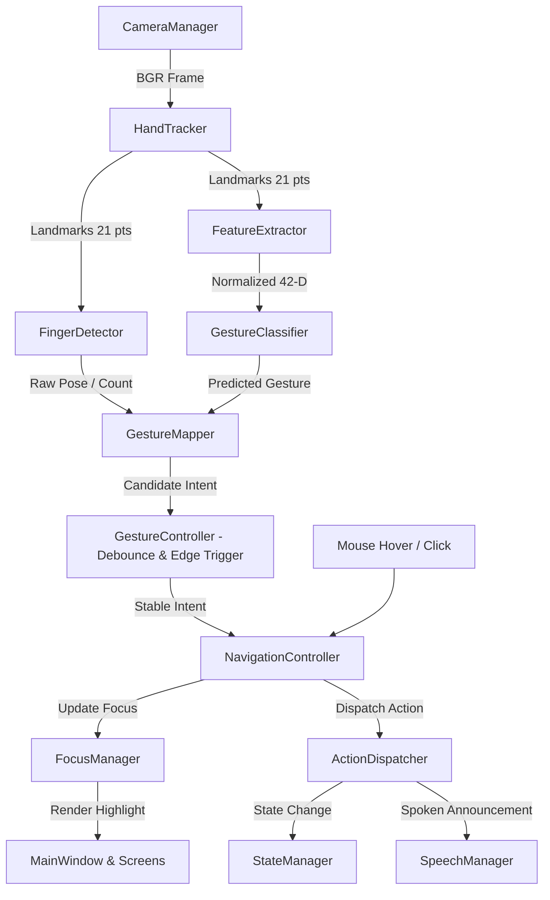

# Hand Gesture & Voice Navigation AI

An accessibility-first real-time desktop application for hand gesture navigation and voice assistance, built using Python, OpenCV, MediaPipe Hands, NumPy, and Scikit-Learn.

The application features dual input modalities (mouse hover/click and hand gestures via webcam) that update a unified focus manager, paired with interruptible, low-latency text-to-speech audio announcements.

---

## Architecture Overview

The codebase is refactored into a clean, modular architecture with strict separation of concerns:

```text
Hand-Gesture-Recognition/
├── main.py                     # Clean application entry point
├── app/                        # Application coordination & configuration
│   ├── __init__.py
│   ├── app_controller.py       # High-level coordinator (owns UI, Vision, Audio, Navigation)
│   ├── config.py               # Centralized path, token, and hardware configuration
│   └── state_manager.py        # ApplicationState enum and StateManager event bus
├── ui/                         # Presentation layer (Tkinter GUI, widgets, styling)
│   ├── __init__.py
│   ├── main_window.py          # Main application window & video rendering
│   ├── styles.py               # Accessible design tokens, high-contrast palette
│   ├── screens/
│   │   ├── main_menu.py        # Main Menu view
│   │   ├── gesture_setup.py    # Gesture Setup sub-menu
│   │   └── help_screen.py      # High-contrast gesture cheat-sheet
│   └── components/
│       ├── navigation_button.py# Accessible menu button with focus indicators
│       ├── focus_indicator.py  # Focus highlight coordinator
│       └── status_bar.py       # Status banner, camera health, and voice bubble
├── gestures/                   # Vision & Hand Gesture Recognition
│   ├── __init__.py
│   ├── camera_manager.py       # OpenCV webcam lifecycle management
│   ├── hand_tracker.py         # MediaPipe Tasks HandLandmarker wrapper
│   ├── feature_extractor.py    # 42-D translation & scale invariant normalizer
│   ├── finger_detector.py      # Rule-based finger counting & pose detector
│   ├── gesture_classifier.py   # Scikit-Learn Random Forest inference engine
│   ├── gesture_mapper.py       # Maps raw poses/counts to canonical intents
│   └── gesture_controller.py   # Multi-frame debounce, fast-path & edge trigger
├── voice/                      # Audio Output & Speech Assistance
│   ├── __init__.py
│   ├── speech_engine.py        # Windows SAPI and pyttsx3 fallback engines
│   ├── speech_queue.py         # Thread-safe bounded, deduplicated message queue
│   ├── interruption.py         # Instant open-palm interruption handler
│   └── speech_manager.py       # High-level speech facade (worker thread)
├── navigation/                 # Shared Navigation & Input Synchronization
│   ├── __init__.py
│   ├── focus_manager.py        # State of selected item (shared across mouse & gestures)
│   ├── action_dispatcher.py    # Executes activations for menu items and commands
│   └── navigation_controller.py# Unifies gesture intents and mouse hover/click
├── ml/                         # Machine Learning Training & Datasets
│   ├── __init__.py
│   ├── dataset_manager.py      # Records gesture images and keypoint CSV data
│   ├── model_trainer.py        # Trains Random Forest classifier with stratified split
│   ├── model_loader.py         # Safe verification and deserialization of models
│   └── evaluation.py           # Accuracy evaluation and confusion matrix plotting
├── data/                       # Runtime data, datasets, and serialized models
│   ├── datasets/               # Keypoint CSV dataset and class sample folders
│   ├── models/                 # rf_model.pkl, confusion_matrix.png, hand_landmarker.task
│   └── config/                 # Application runtime configurations
├── tests/                      # Automated unit and integration test suite
│   ├── test_paths.py           # Path resolution & dataset integrity tests
│   ├── test_state.py           # State transitions and listener tests
│   ├── test_navigation.py      # Shared focus, mouse/gesture synchronization tests
│   ├── test_gestures.py        # Finger detection, normalization, debounce tests
│   ├── test_voice.py           # TTS queue deduplication & interruption tests
│   ├── test_ml.py              # Model loading, evaluation, and dataset tests
│   └── test_voice_navigation.py# Full integration test suite for navigation and voice
├── requirements.txt            # Python dependencies
├── README.md
└── .gitignore
```

---

## Module Communication Flow

The application follows a clean, single-direction data flow:



### Key Principles
1. **Multi-Modal Focus Synchronization**: Mouse hover/clicks and hand gestures modify the exact same `FocusManager`. Hovering changes focus without activating; clicking or 3 fingers activates.
2. **Open-Palm Speech Interruption**: Showing an open palm (5 fingers) triggers an immediate 2-frame fast-path interruption that purges the hardware speech buffer and clears queued announcements without triggering menu actions. A re-arm latch prevents continuous interruptions while holding the palm.
3. **Edge-Triggered Navigation**: Holding a static gesture pose triggers the navigation action exactly once until the hand returns to neutral or transitions to a different gesture.
4. **Thread Safety**: Camera frame capture, ML model training, and audio output operate off the Tkinter main thread. All widget updates are safely scheduled on the Tkinter main loop.

---

## Canonical Gesture Mapping

| Gesture | Finger Pose | Action | Priority |
| :--- | :--- | :--- | :--- |
| **Open Palm** | 5 fingers extended | **STOP SPEECH** (Immediate Mute) | **Highest (Fast-path 2 frames)** |
| **1 Finger** | Index extended | **Next** option in active menu | Normal (Edge-triggered) |
| **2 Fingers** | Index + Middle extended | **Previous** option in active menu | Normal (Edge-triggered) |
| **3 Fingers** | 3 fingers extended | **Select** / Activate focused option | Normal (Edge-triggered) |
| **Closed Fist** | All fingers folded | **Back** / Cancel | Normal (Edge-triggered) |

---

## Setup & Installation

### 1. Prerequisites
- Python 3.10 – 3.12 recommended.
- Webcam (built-in or USB).
- Audio output device (speakers or headphones).

### 2. Clone and Setup Environment
```bash
# Clone the repository
git clone https://github.com/utkarsh-ooty/Hand-Gesture-Recognition.git
cd Hand-Gesture-Recognition

# Create virtual environment
python -m venv venv
venv\Scripts\activate   # Windows
# source venv/bin/activate # macOS/Linux

# Install dependencies
pip install -r requirements.txt
```

### 3. Launch Application
```bash
python main.py
```

---

## Running the Automated Test Suite

Run the full automated test suite:
```bash
python -m unittest discover -s tests
```

To run a specific test module:
```bash
python -m unittest tests/test_voice_navigation.py
python -m unittest tests/test_navigation.py
python -m unittest tests/test_gestures.py
```

---

## Canonical Data and Model Locations
- Runtime datasets are stored in `data/datasets/` (`keypoint_dataset.csv` and sample folders).
- Serialized models and assets are located in `data/models/`:
  - `hand_landmarker.task` — MediaPipe Hand Landmarker model.
  - `rf_model.pkl` — Trained Scikit-Learn Random Forest model.
  - `confusion_matrix.png` — Model evaluation confusion matrix.
- Configuration and runtime metadata reside in `data/config/`.
