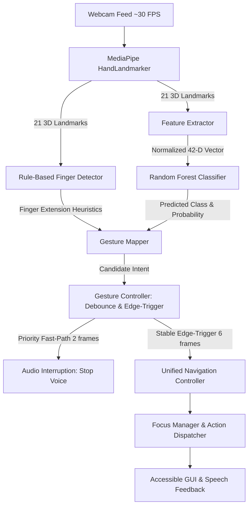

# Project Documentation: Hand Gesture & Voice Navigation AI

## 1. Project Overview
The **Hand Gesture & Voice Navigation AI** is an accessibility-first, real-time desktop application designed for hands-free computer interaction. By integrating computer vision, machine learning, and speech synthesis, the system enables users to navigate graphical user interfaces using natural hand gestures and audible voice feedback. It serves as an assistive technology solution for users with physical impairments or individuals operating in touch-free environments (such as healthcare and sterile workstations).

---

## 2. Algorithms and Technical Methodology

The system uses a hybrid approach combining **deep learning landmark estimation**, **mathematical normalization**, **rule-based geometric heuristics**, **machine learning classification**, and **stateful temporal debounce algorithms**.

### A. Hand Landmark Detection (MediaPipe Tasks)
* **Model**: Google MediaPipe `HandLandmarker` (Tasks API).
* **Operation**: Tracks 21 distinct 3D anatomical hand landmarks (wrist, MCP, PIP, DIP, and fingertips) at ~30 FPS with high precision and low CPU overhead.

### B. Mathematical Feature Extraction & Normalization
To ensure recognition is invariant to hand distance (scale) and position on screen (translation), raw $(x, y)$ coordinates from all 21 keypoints are transformed into a normalized 42-dimensional vector:
1. **Translation Invariance**: The wrist joint $(x_0, y_0)$ is established as the local origin:
   $$(x_i', y_i') = (x_i - x_0, y_i - y_0) \quad \text{for } i \in \{0, \dots, 20\}$$
2. **Scale Invariance**: Coordinates are normalized using $L_\infty$ maximum coordinate magnitude:
   $$(x_i'', y_i'') = \frac{(x_i', y_i')}{\max_{j}(|x_j'|, |y_j'|)}$$
3. **Feature Vector**: Flattened into a 42-dimensional array $[x_0'', y_0'', \dots, x_{20}'', y_{20}'']$.

### C. Rule-Based Geometric Heuristic Detection (`FingerDetector`)
* Computes Euclidean distances between fingertips, PIP joints, and the wrist relative to palm size (wrist to middle MCP distance).
* Evaluates thumb abduction angle against the pinky base.
* Provides deterministic, zero-latency detection for canonical finger counts:
  * **0 fingers / Fist**: Back / Cancel
  * **1 finger (Index)**: Next option
  * **2 fingers (Index + Middle)**: Previous option
  * **3 fingers**: Select / Activate
  * **5 fingers / Open Palm**: Immediate voice interruption

### D. Machine Learning Classification (`Random Forest`)
* **Algorithm**: `RandomForestClassifier` (100 estimators, stratified split).
* **Input**: 42-dimensional normalized coordinate feature vector.
* **Classes Recognized**: `open_palm`, `closed_fist`, `thumbs_up`, `thumbs_down`, `swipe_left`, `swipe_right`.
* **Inference**: Predicts class labels with confidence thresholding ($\ge 0.60$) to filter out ambiguous or transitioning poses.

### E. Stateful Temporal Debounce and Edge-Triggering (`GestureController`)
To prevent erratic navigation and accidental multiple inputs:
* **Dual-Path Temporal Windowing**:
  * **Priority Fast-Path (2 frames, ~66 ms)**: Dedicated to the *Open Palm* gesture to instantly stop and mute spoken audio announcements.
  * **Navigation Stability Window (6 frames, ~200 ms)**: Requires candidate navigational gestures to remain steady across a sliding frame buffer before dispatching.
* **Edge-Trigger Latch**: Holding a static pose triggers the action only once until the hand returns to neutral or transitions to a different pose.
* **Cooldown Guard**: Enforces a 400 ms cooldown period between distinct consecutive navigation actions.

### F. Multi-Modal Synchronization & Audio Queue
* **Unified Focus Management**: Mouse hover/clicks and hand gestures update the exact same `FocusManager`, eliminating input collisions.
* **Asynchronous Audio Pipeline**: Spoken announcements run in dedicated worker threads with speech deduplication (1.0-second window) and hardware buffer purging via Windows SAPI / `pyttsx3`.

---

## 3. Canonical Gesture Mapping

| Gesture | Pose Details | Action Mapped | Priority / Trigger |
| :--- | :--- | :--- | :--- |
| **Open Palm** | All 5 fingers extended | **STOP SPEECH** (Mute Audio) | **High Priority** (Fast-path: 2 frames) |
| **1 Finger** | Index extended | **Next** Option / Menu item | Normal (6-frame debounce, edge-triggered) |
| **2 Fingers** | Index + Middle extended | **Previous** Option / Menu item | Normal (6-frame debounce, edge-triggered) |
| **3 Fingers** | 3 fingers extended | **Select** / Activate Option | Normal (6-frame debounce, edge-triggered) |
| **Closed Fist** | All fingers folded | **Back** / Return / Cancel | Normal (6-frame debounce, edge-triggered) |

---

## 4. Key Outcomes and Results

1. **Contactless, Accessible User Experience**:
   * Users can operate the entire desktop interface (navigation, selection, cancellation, and audio guidance) without touching a keyboard or mouse.
   * High-contrast UI theme conforming to accessibility contrast guidelines for visually impaired users.

2. **Ultra-Low Latency & Real-Time Responsiveness**:
   * Operates at ~30 FPS on standard consumer webcams without dedicated GPU hardware.
   * Open-palm audio muting responds in under 70 ms, giving immediate tactile control over speech.

3. **High Reliability with Zero Accidental Triggers**:
   * Translation and scale normalization remove dependency on camera distance or hand placement.
   * Edge-triggered debouncing eliminates continuous scrolling or repeated activations when a user holds their hand up.

4. **Multi-Modal Coexistence**:
   * Mouse and vision inputs operate in harmony without race conditions or focus desynchronization.

5. **Integrated Training and Evaluation Pipeline**:
   * Includes built-in keypoint data collection, stratified model retraining, automated confusion matrix generation, and validation accuracy reporting.

